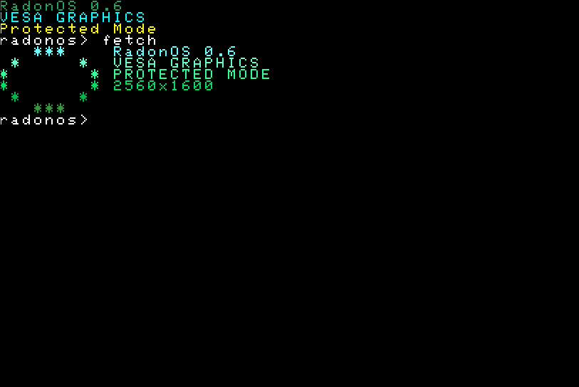
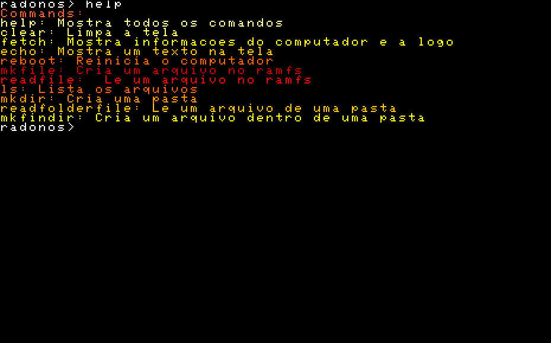
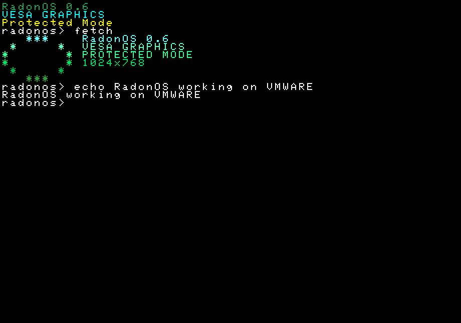

# RadonOS 0.6 SIMPLE OS MAKE IN C AND ASSEMBLY 🇧🇷
## 💾 BOOTLOADER(VESA GRAPHICS,RESOLUTION,PROTECTED MODE) https://github.com/carbrit
## 💻 OS(TERMINAL,COMMANDS,DRAW,RAMFS,STRING FUNCTIONS,ETC) BY ME

## TESTS

